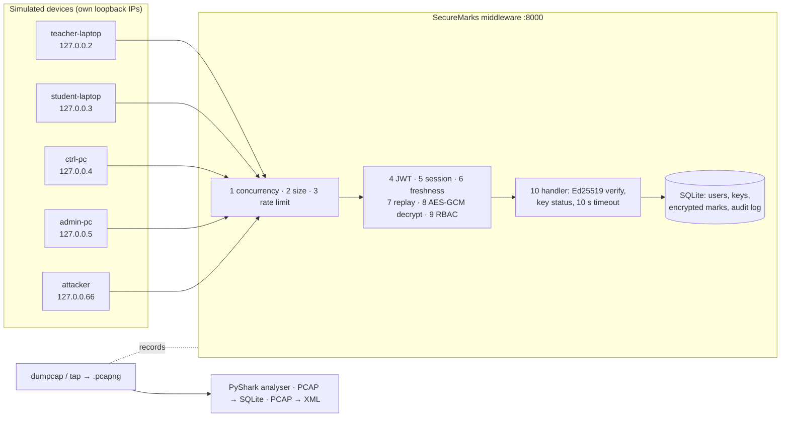

# SecureMarks

A policy-driven **security middleware** (FastAPI) with a **student marks portal** (Streamlit) on top. Teachers
publish marks, students see only their own, and every encryption, signature, replay check and rate-limit decision is
shown live in an inspector and proven on the wire with a packet capture.

> **The pitch:** the app only says "confidential". The middleware picks the algorithms, manages the keys, blocks
> replays and floods, and logs every decision, and the capture proves it.

Everything runs on one Windows laptop. Five "devices" (teacher, student, exam controller, admin, attacker) are
simulated with their own loopback IP addresses, so a capture shows five separate hosts.

For *why* each mechanism exists and exactly where it lives in the code, read **[docs/REPORT.md](docs/REPORT.md)**.

---

## Contents

1. [What is in the box](#1-what-is-in-the-box)
2. [Install (once)](#2-install-once)
3. [Run the demo](#3-run-the-demo)
4. [Demo accounts](#4-demo-accounts)
5. [Using the portal, page by page](#5-using-the-portal-page-by-page)
6. [Security analysis: the attacks](#6-security-analysis-the-attacks)
7. [Traffic and PCAP analysis](#7-traffic-and-pcap-analysis-isl-modules-7-and-4)
8. [Understanding the analysis outputs](#8-understanding-the-analysis-outputs)
9. [Efficiency analysis: the benchmark](#9-efficiency-analysis-the-benchmark)
10. [The 12-minute demo script](#10-the-12-minute-demo-script)
11. [Troubleshooting](#11-troubleshooting)
12. [Project layout](#12-project-layout)

---

## 1. What is in the box



| Process | Command | Port |
|---|---|---|
| Middleware (the security layer) | `uvicorn middleware.main:app --host 127.0.0.1 --port 8000 --workers 1` | 8000 |
| Portal + client SDK | `streamlit run portal\Home.py` | 8501 |
| Recording tap (only without Npcap) | `python -m analysis.tap` | 8000 → server on 8001 |
| Capture and analysis | `python -m analysis.capture`, `analysis.analyze`, `analysis.pcap_to_sqlite` | — |
| Attack scripts | `python -m attacks.<name>` | — |

**Algorithms (all from the `cryptography` library, no hand-written crypto):** X25519 + HKDF-SHA256 for session keys,
AES-GCM for every protected body (in transit and at rest), SHA-256 record hashes, Ed25519 record signatures, Argon2id
passwords, HS256 JWTs. RSA-OAEP / RSA-PSS are kept as the `legacy-rsa` comparison policy and in the benchmark.

---

## 2. Install (once)

Everything below is PowerShell, run in the project folder.

1. **Python 3.11 or newer** from python.org (tick *Add python.exe to PATH*).
2. **Wireshark with Npcap** (recommended, for real captures and PyShark). In the Npcap installer keep
   **Support loopback traffic capture** ticked and include **TShark**.
   *No Wireshark?* The project still works: captures go through the built-in recording tap, and the analyser
   falls back to its own pcapng reader (see [section 7](#7-traffic-and-pcap-analysis-isl-modules-7-and-4)).
3. Create the virtual environment and install:

   ```bash
   py -3 -m venv .venv
   ```

   ```bash
   .\.venv\Scripts\Activate.ps1
   ```

   ```bash
   pip install -r requirements.txt
   ```

   If PowerShell blocks the activation script, run `Set-ExecutionPolicy -Scope CurrentUser RemoteSigned` once.
4. Create keys, users and the database:

   ```bash
   python scripts\setup_demo.py --reset
   ```

   This writes `.env` (with a fresh `JWT_SECRET`), the master key `secrets\master.key`, data key v1, the five seed
   users (Argon2id hashes), t104's Ed25519 keypair (private half in `client_keys\t104_ed25519.pem`, encrypted with
   t104's password), the P1 RSA keys and TLS certificate, and one seeded record for roll 240911612.
5. Check that everything is green:

   ```bash
   python -m pytest -q
   ```

   Expect `39 passed` (crypto core, guards and the full marks flow, each in a throw-away database).

---

## 3. Run the demo

One command opens a console window for each process and then the browser:

```bash
python scripts\run_demo.py
```

| Option | What it does |
|---|---|
| *(none)* | Uses dumpcap if Wireshark is installed; otherwise starts the server on 8001 and the recording tap on 8000 |
| `--tap` | Forces tap mode |
| `--tls` | Also starts the HTTPS server on 8443 (P1, for experiment 2) |
| `--reset` | Runs `setup_demo.py --reset` first (close the old windows before!) |
| `--no-portal`, `--no-browser` | Skip the portal or the browser |

Prefer three terminals? Activate the venv in each and run:

```bash
uvicorn middleware.main:app --host 127.0.0.1 --port 8000 --workers 1 --no-access-log
```

```bash
streamlit run portal\Home.py
```

```bash
python -m analysis.capture start --name exp_live
```

The **server console** is the third screen of the demo: every check prints one coloured line, for example
`[7f3a] PASS aesgcm_decrypt AES-256-GCM 284 B → 268 B plaintext …`.

**Screen layout for the demo:** teacher window on the left (`http://localhost:8501`), a *second* browser window on
the right for the student (each browser tab is its own Streamlit session, so it acts as a separate device), the server
console at the bottom, Wireshark on a second desktop.

---

## 4. Demo accounts

Demo-only passwords. The Home page also has one-tap sign-in buttons.

| User | Password | Role | Can | Device |
|---|---|---|---|---|
| `t104` | `teach@104` | Teacher (IT301) | publish marks for own course | teacher-laptop 127.0.0.2 |
| `s608` | `stud@608` | Student, roll 240911608 | view own marks, verify the signature | student-laptop 127.0.0.3 |
| `s612` | `stud@612` | Student, roll 240911612 | (the flood's stolen token) | student-laptop 127.0.0.3 |
| `ctrl` | `ctrl@exam` | Exam controller | verify hashes and signatures, read the audit log, never sees marks | ctrl-pc 127.0.0.4 |
| `admin` | `admin@sm` | Admin | list, rotate and revoke keys, read the audit log | admin-pc 127.0.0.5 |

---

## 5. Using the portal, page by page

| Page | Who | What to do | What to look at |
|---|---|---|---|
| **Home** | everyone | Sign in (form or one-tap) | Your device and IP in the sidebar, middleware status, the ten checks |
| **Publish** | t104 | Course, roll, midsem, endsem → *Sign and publish*. Toggle the plain baseline for experiment 1 | The confirmation card (record, version, SHA-256), *On the wire* (the real HTTP request, ciphertext body), the **inspector** |
| **My Marks** | s608 / s612 | Opens automatically. Try another roll number at the bottom | Green *Verified · signed by t104 · fingerprint*, or red *Signature invalid*. The friend's roll returns `403 forbidden` |
| **Verify Audit** | ctrl (admin sees the log) | Verify a record ID; filter the audit log | `SHA-256 matches` / `signature valid` with **no marks shown**; the *hash chain intact* badge |
| **Keys** | admin | Revoke t104, rotate the data key | Data keys (wrapped), signing keys (public halves only), the inspector of the admin call |
| **Crypto Playground** | everyone | Four tabs: AES-GCM, SHA-256 avalanche, Ed25519, X25519 | Flip a ciphertext bit → `InvalidTag`; one character → ~128 of 256 bits flip; edit a signed message → `InvalidSignature`; Alice = Bob ≠ Eve |
| **Attack Lab** | everyone | Run the commands listed there in a terminal | Every refused request in the audit log, and the server trace of any one of them |
| **Traffic Lab** | everyone | Start/stop a capture, pick a `.pcapng`, *Run analyser*, *PCAP → SQLite*, *Export XML*, *Open in Wireshark* | Entropy, overhead, latency and rate graphs; `messages.csv`, `flows.csv`, `flags.csv`; the SQL join |
| **Benchmarks** | everyone | *Run quick benchmark* | The goal matrix with measured costs, throughput and comparison graphs |

**The inspector** (under Publish, My Marks, Verify and Keys) is one table that merges the SDK's client-side steps
with the server's steps for the same request, in time order: `build_record → canonicalize → sha256 → ed25519_sign →
x25519_keypair → hkdf_derive → aesgcm_encrypt → send →` *(server)* `concurrency → size_cap → rate_limit → auth_jwt →
session_lookup → policy_check → freshness → replay_check → aesgcm_decrypt → rbac → sig_verify → encrypt_at_rest →
aesgcm_encrypt_response → audit_write →` *(student)* `aesgcm_decrypt_response → sha256_recompute → ed25519_verify`.
Keys are always shown truncated (`4c1e…9a02`).

---

## 6. Security analysis: the attacks

All attacks come from the attacker device (127.0.0.66). A "stolen token" is issued to the victim's own device and
then used from the attacker's address. Run them with the venv active while the server is up.

| Command | What it does | Expected | Goal tested |
|---|---|---|---|
| `python -m attacks.tamper_cipher` | Flips one bit of a valid protected publish in flight | `400 integrity_failed` | Integrity |
| `python -m attacks.tamper_db` | Malicious DB admin decrypts t104's record, changes endsem 45 → 95, re-encrypts | Student sees **Signature invalid**; controller verify reports both checks false | Integrity, authenticity |
| `python -m attacks.tamper_db --swap` | Copies another student's ciphertext into the row | `500 record_integrity_failed` (AAD binds course and roll) | Integrity |
| `python -m attacks.replay --last` | Resends the last captured publish byte for byte | `409 replay_detected` | Replay resistance |
| `python -m attacks.replay --last --delay 35` | Same, after the 30 s window | `409 stale_request` | Replay resistance |
| `python -m attacks.idor` | s608 asks for roll 240911612 | `403 forbidden`, audited as `idor_blocked` | Authorisation |
| `python -m attacks.forge_sig` | Stolen t104 token, attacker's own signing key | `400 bad_signature` | Authentication |
| `python -m attacks.revoked_key --revoke-first` | Admin revokes t104, then a publish with that key | `403 key_revoked` | Authentication, key management |
| `python -m attacks.bad_login` | 20 wrong passwords in 5 s | `401` then `429 rate_limited` | Authentication, availability |
| `python -m attacks.flood --seconds 10 --rate 50 --probe` | 500 valid encrypted requests with a stolen s612 token, while s608 loads marks every second | ~94 % `429`; s608 keeps getting `200` near baseline latency | Availability |

Each script prints the expected and actual result, the **audit-log row with the same request ID**, and the
server's step-by-step trace. Results from the rehearsal run: every attack produced its expected code (flood: 471 of
500 refused with 429, and s608 got 15/15 answers at a 7 ms median).

**Undo helpers for repeated rehearsals:** `python -m attacks.tamper_db --restore` puts the edited row back;
`python scripts\setup_demo.py --rekey t104` issues t104 a new key after a revocation; `python -m attacks.tamper_db
--audit` deliberately breaks the audit hash chain (P1 demo; only `--reset` repairs it).

---

## 7. Traffic and PCAP analysis (ISL modules 7 and 4)

### Capturing

| Mode | When | How it works |
|---|---|---|
| **dumpcap** (default) | Wireshark + Npcap installed | `dumpcap -i \Device\NPF_Loopback -f "tcp port 8000 or tcp port 8443" -w captures\<name>.pcapng`, stopped cleanly with CTRL_BREAK |
| **tap** (fallback) | No Npcap | `analysis.tap` relays port 8000 → 8001 byte for byte and writes each chunk as an IPv4/TCP frame on a loopback-type interface. Real payloads, endpoints and timing; the TCP framing is synthesised by the relay |

```bash
python -m analysis.capture start --name exp1_plain_vs_protected
```

```bash
python -m analysis.capture stop
```

`status` and `list` are also available. PyShark never runs inside Streamlit; analysis always runs in its own process.

### The five experiments, scripted

Each command starts a capture, drives the traffic from the right devices, stops the capture and analyses it:

```bash
python -m analysis.experiments exp1
```

| Key | Capture file | What happens | Evidence |
|---|---|---|---|
| `exp1` | `exp1_plain_vs_protected` | Same record to `/plain/publish` and `/api/marks/publish`; both views; 1/4/10/100 KB payload sweep | Marks readable vs unreadable, entropy and overhead graphs |
| `exp2` (`exp2_tls`, P1) | `exp2_http` / `exp2_tls` | Login + publish over HTTP (and HTTPS with `run_demo.py --tls`) | Password and JWT visible over HTTP; only sizes and timing over TLS |
| `exp3` | `exp3_replay` | Publish, replay at once, replay after 35 s (~40 s) | Same request ID twice → `replay_detected`, then `stale_request`, both joined to their audit rows |
| `exp4` | `exp4_flood` | 10 s flood at 50 req/s + student probe | Rate spike, 429s, student latency close to baseline |
| `exp5` | `exp5_devices` | One action from each of the five devices | Five hosts; `403` on the friend's roll; latency per device |

`all` runs 1–5 in a row. Add `--no-capture` to only generate traffic.

### Analysing any capture

```bash
python -m analysis.analyze captures\exp3_replay.pcapng --audit data\securemarks.db
```

```bash
python -m analysis.pcap_to_sqlite captures\exp3_replay.pcapng
```

```bash
python -m analysis.pcap_to_xml captures\exp1_plain_vs_protected.pcapng
```

The analyser uses **PyShark** when tshark is installed (`--engine pyshark`) and its pure-Python pcapng reader
otherwise (`--engine python`); the summary line says which one ran.

---

## 8. Understanding the analysis outputs

Everything lands in `analysis\out\<capture name>\`.

### How the analyser works

1. **Read packets** on the server ports (PyShark `FileCapture`, filter `tcp.port==8000`; a second pass counts
   `tcp.analysis.retransmission`).
2. **Rebuild HTTP** from raw TCP payloads: group by stream and direction, order by sequence number, drop
   retransmitted bytes, split by headers + `Content-Length`. Working from raw bytes keeps binary ciphertext intact.
3. **Pair** the n-th request with the n-th response in each TCP stream (keep-alive keeps them in order).
4. **One row per request** (`messages.csv`), then **flags**, then a **cross-check** of every flag against
   `audit_log` by request ID.

### `messages.csv` (one row per request)

| Column | Meaning |
|---|---|
| `req_ts`, `resp_ts`, `latency_ms` | Capture timestamps of the first request frame and last response frame, and the difference |
| `src_ip`, `device` | Source address and the simulated device (IP map first, `X-Device` header if loopback IPs collapsed) |
| `method`, `path`, `status`, `error_code` | The call and its outcome (`error_code` read from the JSON error body) |
| `request_id`, `x_timestamp`, `policy` | The replay-protection headers |
| `req_body_bytes`, `resp_body_bytes` | HTTP body sizes |
| `wire_bytes` | Sum of the frame lengths carrying the request and response (headers, nonce, tag, IP/TCP overhead included) |
| `req_entropy`, `resp_entropy` | Shannon entropy of each body in bits per byte |
| `req_kind`, `resp_kind` | `plain` (/plain/*), `protected` (octet-stream ciphertext) or `control` (login, handshake, lookups, errors) |
| `small_sample` | Body under 256 B: entropy reads low for small samples, so these are reported separately |
| `flag` | `replay`, `replay_late` or `flood` (below) |

### `flows.csv` (one row per TCP connection)

Client, server, ports, device, packets, bytes, payload bytes, duration, **retransmissions**, HTTP requests carried, and
for TLS streams (port 8443) the entropy of the encrypted records. For TLS that is all there is to see: content
hidden, metadata (sizes, timing, who talks to whom) visible.

### Flags and `flags.csv`

| Flag | Rule |
|---|---|
| `replay` | The request ID was already seen in the capture within 30 s |
| `replay_late` | The same request ID again, but more than 30 s later (the server answers `stale_request`) |
| `flood` | The source sent more than 5 requests in some 1-second window |

`flags.csv` adds `audit_id`, `audit_action`, `audit_outcome`, `audit_code` and `audit_match`: the audit row with the
same request ID that is nearest in time. Any flag **without** an audit row is listed too: that would be a gap in
accountability. In the rehearsal every flag matched (exp3: 2/2, exp4: 500/500).

### The four graphs

| Graph | How to read it | Rehearsal result |
|---|---|---|
| `entropy_plain_vs_protected.png` | Entropy per body. Filled dots = bodies ≥ 256 B, hollow = small samples. Dashed line = 8 bits/byte (random) | Plain JSON ≥ 1 KB: **4.39** bits/byte. AES-GCM ciphertext ≥ 1 KB: **7.96**. The PRD expects 4–5 vs 7.8+ |
| `overhead_bytes.png` | Per endpoint, mean body bytes vs bytes on the wire; the label shows the difference | Protected publish **1,580 B** on the wire vs plain publish **815 B** (same marks): session headers, nonce, tag, request-ID metadata |
| `latency_by_device.png` | Box plot of latency per device, median labelled | 4–7 ms per device on loopback |
| `rate_timeline.png` | Requests per second per device; red × = number of 429s that second | exp4: attacker flat at 50 req/s, ~48 of them refused each second, student flat at 1 req/s |

### PCAP → SQLite (module 4)

`data\capture_<name>.db` holds two tables, `packets` (every TCP packet: frame, time, addresses, ports, stream,
length, retransmission flag) and `http_messages` (every row of `messages.csv`). The script attaches the main
database and runs the PRD's join:

```sql
ATTACH 'data/securemarks.db' AS app;
SELECT m.ts, m.device, m.request_id, m.status, a.action, a.outcome, a.code
FROM http_messages m
LEFT JOIN app.audit_log a ON a.request_id = m.request_id
WHERE m.flag IN ('replay', 'flood')
ORDER BY m.ts;
```

A replayed request ID has two audit rows (the original publish and the refused replay), so the script also runs a
refined join that picks the nearest row in time, and saves it as `audit_join.csv`. In exp3 that gives exactly: replay
→ `marks_publish denied replay_detected`, late replay → `marks_publish denied stale_request`.

### PCAP → XML (P1)

With tshark: `tshark -r <pcap> -T pdml` (full PDML). Without it: a compact XML of every packet and every HTTP message
(headers, plain JSON bodies as text, ciphertext as hex). Open `analysis\out\exp2_http.xml` and search for
`"password"`: the login body is readable over plain HTTP, which is the finding of experiment 2.

---

## 9. Efficiency analysis: the benchmark

```bash
python -m bench.bench --quick
```

About 30–60 s (`--full` adds 50 MB payloads, RSA-3072, ECDSA P-256 and 200 round trips). Outputs in `bench\out\`:
`results.csv`, `results.json`, and `sym_throughput.png`, `sig_compare.png`, `kex_compare.png`, `e2e_latency.png`,
`checks_cost.png`. Timings are medians with warm-up runs (`time.perf_counter()`).

| Measured (quick run, this laptop) | Value | Reading |
|---|---|---|
| AES-256-GCM encrypt @ 1 MB | 2,856 MB/s | Encryption is never the bottleneck |
| SHA-256 @ 1 MB | 2,194 MB/s | |
| Ed25519 sign / verify / keygen | 0.023 / 0.066 / 0.023 ms | Keys 32 B, signatures 64 B |
| RSA-PSS-2048 sign / verify / keygen | 0.39 / 0.024 / 30.5 ms | Keys 294 B, signatures 256 B: 17× slower signing, 1,300× slower keygen, faster verify |
| X25519 handshake vs RSA-OAEP-2048 vs DH-2048 | 0.096 vs 0.42 vs 0.83 ms | X25519 is the cheapest and smallest (64 B on the wire) |
| Argon2id hash / verify | 33 / 54 ms | Deliberately slow: it is what makes password guessing expensive |
| Seen-ID lookup / token bucket / RBAC / JWT verify / audit write | 0.2 / 0.4 / 0.2 / 30 / 683 µs | The audit write (hash chain + WAL commit) is the largest per-request cost |
| End to end p50 (p95): protected publish vs plain | 11.2 (14.5) ms vs 4.9 (5.3) ms | The full cost of security per call is about 6 ms on loopback |

The Benchmarks page turns these numbers into the **goal matrix**: each security goal, its mechanism, its attack and
its measured cost.

---

## 10. The 12-minute demo script

Before they arrive: `python scripts\run_demo.py --reset`, then start capture `exp_live` (Traffic lab or CLI), and open
the Crypto playground.

1. **Pitch (1 min).** The architecture above; modules implemented: Traffic Analysis (Wireshark + PyShark) and PCAP
   Analysis (PCAP → SQLite, PCAP → XML).
2. **Crypto playground (2 min).** Flip a byte → `InvalidTag`; SHA-256 avalanche; edit a signed message; Eve's secret.
3. **Publish (1.5 min).** t104 publishes; walk down the inspector: hash, signature, session key, nonce, ciphertext,
   then the server's checks.
4. **View (1 min).** s608 sees *Verified · signed by t104*; tries roll 240911612 → 403.
5. **Wireshark (1.5 min).** Follow HTTP stream: `/plain/publish` shows the marks, `/api/marks/publish` shows random
   bytes, the handshake shows two public keys and no session key.
6. **Attacks (2.5 min).** `tamper_cipher` → 400; `tamper_db` → *Signature invalid*; `replay --last` → 409; `flood`
   → 429s while the student page still loads; `revoked_key --revoke-first` → 403.
7. **Evidence (2 min).** Stop the capture, *Run analyser* and *PCAP → SQLite* in the Traffic lab; benchmark graphs.
8. **Close (0.5 min).** The goal matrix on the Benchmarks page.

**Backup plan:** after the rehearsal run `python scripts\backup_demo.py`; it copies captures, CSVs, graphs and a
consistent copy of the databases to `demo_backup\<timestamp>\` (add screenshots there by hand). If anything fails
live, open the matching backup file and carry on.

---

## 11. Troubleshooting

| Symptom | Fix |
|---|---|
| `SecureMarks is not set up` when the server starts | Run `python scripts\setup_demo.py --reset` |
| `--reset` says the database is in use | Close the server and portal windows first |
| Every packet shows 127.0.0.1, or binding to 127.0.0.x fails | Nothing to do: the analyser groups by the `X-Device` header |
| No capture method | Install Wireshark + Npcap with loopback support, or `python scripts\run_demo.py --tap` |
| Port 8000 or 8501 in use | Another copy is running; close it, or use `--port 8010` / `--server.port 8510` and update `SERVER_URL` in `.env` |
| Your own clicks get `429` after the flood | Wait a few seconds for the bucket to refill; the flood used s612's identity, not yours |
| "Your 15-minute token expired" | Sign in again on Home (5 seconds) |
| Replay gives `401 auth_failed` instead of 409 | The captured JWT is older than 15 minutes; publish again, then replay |
| Teacher publish gives `403 key_revoked` | t104 was revoked earlier: `python scripts\setup_demo.py --rekey t104`, then sign in again |
| Audit badge shows *hash chain broken* | `tamper_db --audit` was run; `setup_demo.py --reset` gives a clean chain |
| PowerShell blocks venv activation | `Set-ExecutionPolicy -Scope CurrentUser RemoteSigned` |

---

## 12. Project layout

```text
SecureMarks/
├── config/            policies.yaml (confidential / normal / legacy-rsa), devices.yaml, demo_accounts.yaml
├── middleware/        the security layer
│   ├── crypto/        aead.py (AES-GCM) · kex.py (X25519, HKDF, RSA-OAEP) · sign.py (Ed25519, RSA-PSS)
│   │                  hashing.py (SHA-256, entropy) · canonical.py (the signed record format)
│   ├── keys/          manager.py: KEK, wrapped data keys, rotation, signing-key registry and revocation
│   ├── policy/        engine.py: validated policies, strength ordering
│   ├── auth/          passwords.py (Argon2id) · tokens.py (JWT) · rbac.py (roles, ownership)
│   ├── guards/        concurrency, size, ratelimit (steps 1-3), replay (6-7), timeout
│   ├── secure.py      the envelope: checks 4-9 and the encrypted response
│   ├── records.py     marks at rest (AES-256-GCM, AAD course|roll)
│   ├── audit.py       hash-chained audit log · trace.py: inspector steps + server console
│   ├── api/           auth, session, marks, admin, audit, plain (baseline), demo
│   └── main.py        app factory, middleware order, routers
├── sdk/client.py      SecureClient: device binding, handshake, encrypted calls, signature checks, client trace
├── portal/            Streamlit app: Home.py, pages/1-8, components/ (theme, inspector)
├── attacks/           eight attack scripts + shared evidence helpers
├── analysis/          capture.py, tap.py, packets.py (PyShark + fallback), httpparse.py, analyze.py,
│                      plots.py, pcap_to_sqlite.py, pcap_to_xml.py, experiments.py
├── bench/bench.py     efficiency benchmark
├── scripts/           setup_demo.py, run_demo.py, make_cert.py, backup_demo.py
├── tests/             test_crypto.py, test_guards.py, test_flow.py
└── docs/REPORT.md     concepts, where each one is implemented, ISL compliance
```

Generated and git-ignored: `.env`, `secrets\`, `client_keys\`, `data\`, `captures\`, `analysis\out\`, `bench\out\`,
`demo_backup\`.
