<div align="center">


# SecureMarks

**A policy-driven security middleware for a student marks portal, with a full cryptographic analysis lab.**

Teachers publish signed marks and answer-sheet images. Students see only their own, and verify every signature
on their device. Every encryption, signature, replay check and rate-limit decision is visible live, and is
confirmed on the wire by a packet capture.

`FastAPI` · `React 19` · `cryptography` · `AES-GCM / GCM-SIV` · `Ed25519` · `X25519` · `SHA-256` · `Argon2id` · `PyShark`

</div>

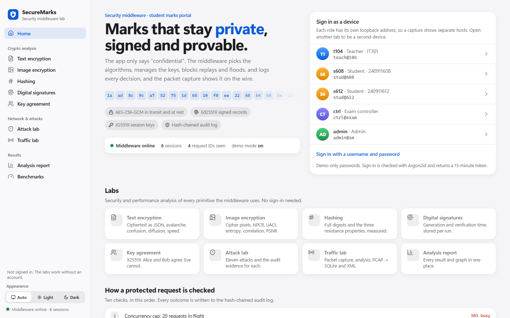

---

## Contents

1. [What it does](#1-what-it-does)
2. [Architecture](#2-architecture)
3. [Quick start](#3-quick-start)
4. [The portal](#4-the-portal)
5. [Security analysis](#5-security-analysis)
6. [Performance analysis](#6-performance-analysis)
7. [Attacks and packet capture](#7-attacks-and-packet-capture)
8. [Requirements coverage](#8-requirements-coverage)
9. [Related lab exercises](#9-related-lab-exercises)
10. [Tests](#10-tests)
11. [Troubleshooting](#11-troubleshooting)
12. [Project layout](#12-project-layout)
13. [Credits and licence](#13-credits-and-licence)

---

## 1. What it does

| Goal | Mechanism | Proven by |
|---|---|---|
| **Confidentiality** | X25519 + HKDF session keys, AES-256-GCM on the wire and at rest | Capture: plain JSON 4.4 bits/byte vs ciphertext 7.96 |
| **Integrity** | GCM tag, SHA-256 record hash, headers bound into the AAD | Flip one ciphertext bit → `400 integrity_failed` |
| **Authentication** | Argon2id passwords, 15-minute JWT, Ed25519 record signatures | Forged signature → `400 bad_signature`; revoked key → `403 key_revoked` |
| **Authorisation** | Role and ownership checks | Student asks for a friend's roll → `403 forbidden` |
| **Replay resistance** | Request ID + timestamp inside the AAD, seen-ID set | Replay → `409 replay_detected`; after 30 s → `409 stale_request` |
| **Availability** | Token bucket, size cap, 10 s timeout, 20-request concurrency cap | Flood: 94 % refused with `429`; the real student is still served at 7 ms |
| **Accountability** | Hash-chained audit log, step-by-step traces | Every attack has an audit row, joined to its packet by request ID |

On top of the middleware sits a **crypto analysis lab**:

- text encryption with confusion, diffusion and avalanche measurements;
- image encryption with NPCR, UACI, entropy, correlation, PSNR and MSE;
- hash digests with pre-image, second-pre-image and collision experiments;
- digital-signature timing.

Every result is graphed, and the measurements are stored.

## 2. Architecture

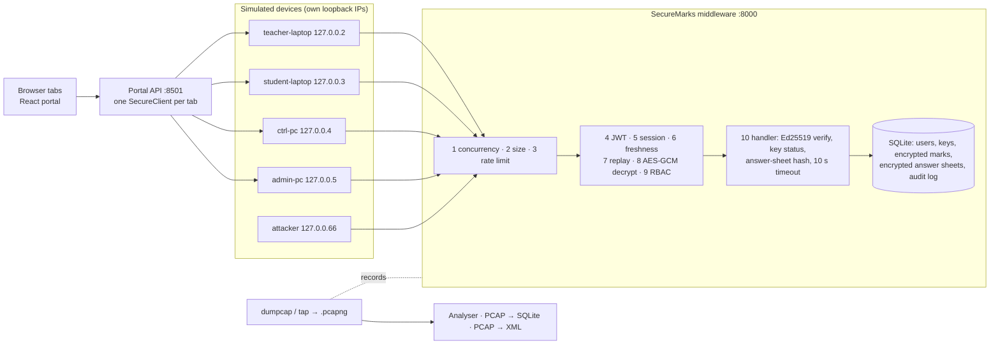

| Process | Port | Role |
|---|---|---|
| `middleware.main:app` | 8000 (8001 behind the tap) | The security layer: ten checks on every protected call |
| `portal_api.main:app` | 8501 | Serves the React app; holds one client SDK per browser tab and runs the crypto labs |
| `analysis.tap` | 8000 → 8001 | Recording relay for laptops without Npcap |

The client-side cryptography (handshake, envelope encryption, signing, verification) lives in the Python SDK
(`sdk/client.py`). Each simulated device binds to its own loopback address, so a capture shows five separate
hosts.

**Algorithms** (all from the [`cryptography`](https://cryptography.io) library, no hand-written crypto in the
security path):

- **Key exchange:** X25519 + HKDF-SHA256.
- **Bodies, on the wire and at rest:** AES-256-GCM.
- **Records:** SHA-256 hashes, Ed25519 signatures.
- **Login:** Argon2id passwords, HS256 JWTs.
- **Comparison and benchmarks:** AES-256-GCM-SIV (RFC 8452), RSA-OAEP / RSA-PSS and ECDSA P-256 in the labs.

## 3. Quick start

Requirements: **Windows 10/11, macOS or Linux**, **Python 3.11+**, **Node.js 18+**. Wireshark with Npcap is
optional; without it, captures use the built-in recording tap.

```powershell
py -3 -m venv .venv
.\.venv\Scripts\Activate.ps1          # macOS/Linux: source .venv/bin/activate
pip install -r requirements.txt
cd web; npm ci; npm run build; cd ..
python scripts\setup_demo.py --reset  # keys, users, database
python -m pytest -q                   # 93 passed
python scripts\run_demo.py --tap      # middleware, tap and portal, then opens the browser
```

Open **http://localhost:8501**. Open a second browser tab to act as a second device (for example, the student).

| User | Password | Role | Device |
|---|---|---|---|
| `t104` | `teach@104` | Teacher (IT301): publishes marks | teacher-laptop 127.0.0.2 |
| `s608` | `stud@608` | Student, roll 240911608 | student-laptop 127.0.0.3 |
| `s612` | `stud@612` | Student, roll 240911612 | student-laptop 127.0.0.3 |
| `ctrl` | `ctrl@exam` | Exam controller: verifies, never sees marks | ctrl-pc 127.0.0.4 |
| `admin` | `admin@sm` | Admin: keys and audit log | admin-pc 127.0.0.5 |

*Demo-only passwords.*

**Generate every analysis result and figure without the UI:**

```powershell
python -m cryptolab.report        # ~10 s → cryptolab/out/*.json|csv|png and docs/figures/lab_*.png
```

## 4. The portal

| Section | Page | What you can do |
|---|---|---|
| Marks portal | **Publish marks** | Teacher signs a record and an optional answer-sheet image, then sends them in an encrypted envelope. Shows the signature, the generation and verification times, the exact ciphertext on the wire (downloadable as JSON) and an inspector of every client and server step |
| | **My marks** | Student decrypts and verifies each record and its answer sheet against the teacher's signature. A friend's roll returns `403` |
| | **Verify & audit** | Exam controller checks the hash and signature without receiving the marks; filters the hash-chained audit log |
| | **Keys** | Admin lists wrapped data keys and public signing keys, rotates the data key, revokes a teacher |
| Crypto analysis | **Text encryption** | Encrypt and decrypt; plaintext, key, nonce, ciphertext and tag in hex and Base64; ciphertext JSON; tamper test; avalanche and key sensitivity; diffusion map; six-mode comparison; time and speed against plaintext length |
| | **Image encryption** | Sample or uploaded image; R, G and B channels; cipher image; 8×8 pixel-value grids; NPCR, UACI, entropy, correlation, PSNR and MSE with pass thresholds; histograms; scatter plots; scheme comparison; speed against image size |
| | **Hashing** | Complete digests for seven algorithms with generation time; avalanche bit grid; pre-image, second-pre-image and collision experiments; throughput |
| | **Digital signatures** | Ed25519, ECDSA, RSA-PSS-2048 and RSA-PSS-3072: sign, verify, tamper; timing distributions; stored history with CSV export |
| | **Key agreement** | X25519: Alice and Bob compute the same secret, Eve does not; the HKDF session key |
| Network & attacks | **Attack lab** | Run eleven attacks, watch their output, inspect the refused requests and server traces |
| | **Traffic lab** | Start and stop captures, run the six experiments, analyse, PCAP → SQLite, export XML |
| Results | **Analysis report** | Requirement coverage, headline numbers, every graph |
| | **Benchmarks** | Security-goal matrix with measured costs, and end-to-end latency |

The sidebar fits the window without scrolling, folds by section, and collapses to an icon rail (button or Ctrl+\\ / ⌘\\). The account menu at its foot holds Auto, Light and Dark appearance (dark is true black) and sign-out. The interface meets WCAG AA contrast, and respects
reduced-motion and reduced-transparency settings. Status is never shown by colour alone.

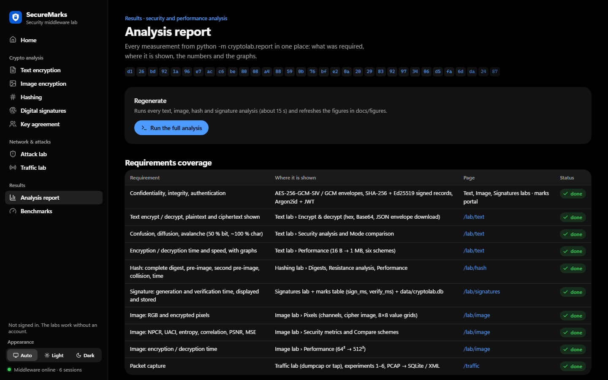

## 5. Security analysis

### Text: confusion, diffusion, avalanche

The text lab flips one plaintext bit (diffusion) or one key bit (confusion), keeping the other inputs and the
nonce fixed. It then counts the ciphertext bits and characters that change. An ideal cipher changes **50 % of
the bits** and **≈ 100 % (255/256) of the characters**.

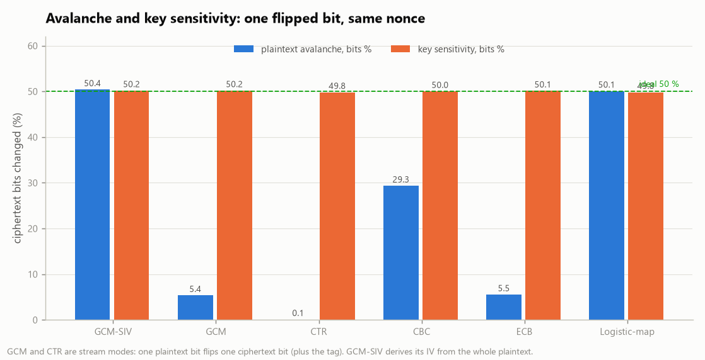

| Scheme | Avalanche, bits | Avalanche, chars | Key sensitivity | Pattern leak |
|---|---|---|---|---|
| **AES-256-GCM-SIV** | **50.07 %** | **99.66 %** | 50.09 % | no |
| AES-256-GCM | 5.51 % | 11.60 % | 49.90 % | no |
| AES-256-CTR | 0.10 % | 0.77 % | 50.02 % | no |
| AES-256-CBC | 29.33 % | 58.22 % | 49.68 % | no |
| AES-256-ECB | 5.49 % | 11.05 % | 49.90 % | **yes** |
| Logistic map (educational) | 49.95 % | 99.76 % | 50.34 % | no |

Stream modes (CTR and GCM) XOR the plaintext with a keystream, so one flipped plaintext bit flips exactly one
ciphertext bit. That is fine in practice, because every message gets a fresh nonce. GCM-SIV derives its IV from
the whole message, so it also passes the fixed-nonce sensitivity test. This is why it is the reference scheme for
the image metrics.

### Image: NPCR, UACI, entropy, correlation, PSNR, MSE

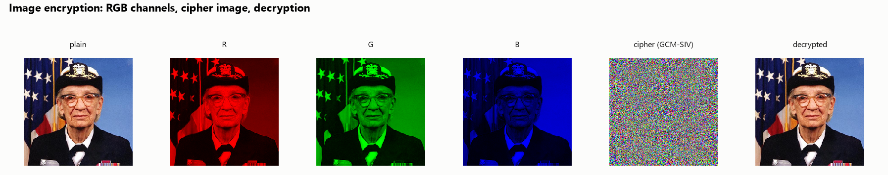

| Metric (256×256 photo, AES-256-GCM-SIV) | Plain | Cipher | Ideal / threshold |
|---|---|---|---|
| NPCR (one pixel changed) | – | **99.6185 %** | 99.6094 %; pass ≥ 99.5693 % (Wu et al. 2011) |
| UACI | – | **33.4042 %** | 33.4635 %; pass 33.2824–33.6447 % |
| Information entropy | 7.4429 | **7.9991** | 8 |
| Correlation H / V / D | 0.948 / 0.957 / 0.919 | **−0.0010 / −0.0044 / −0.0013** | 0 |
| MSE / PSNR (plain vs cipher) | – | 12,496 / **7.16 dB** | high / < 10 dB |
| MSE / PSNR (plain vs decrypted) | – | 0 / ∞ | lossless |

| Adjacent-pixel correlation | Histograms |
|---|---|
| 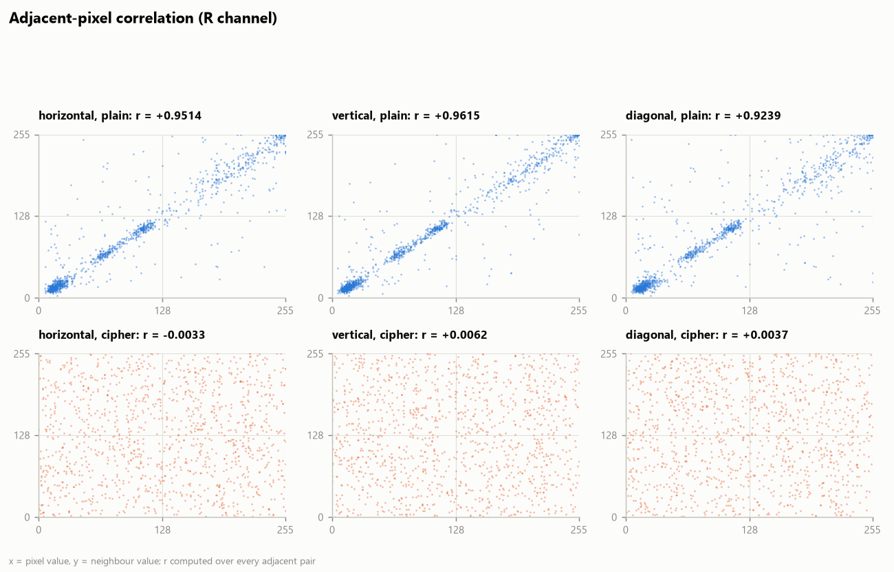 | 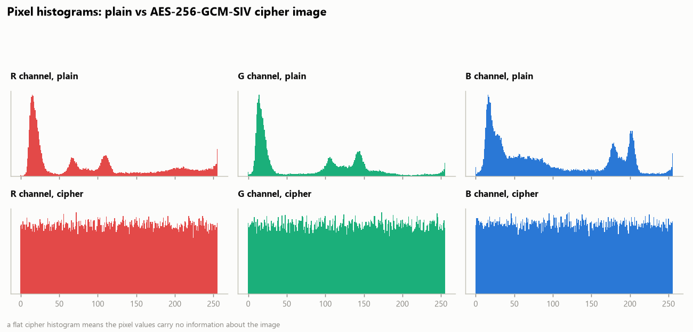 |

Why one metric is never enough: ECB looks fine on a noisy photo, but on flat colours it keeps the shape.

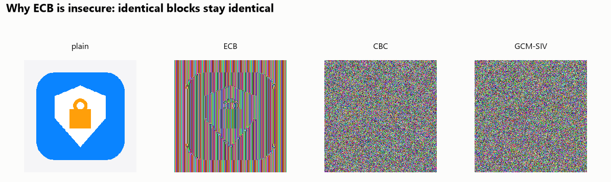

### Hashing: the three resistance properties

The lab brute-forces the first *k* bits of real SHA-256 digests. The measured effort follows **2ᵏ** for
pre-image and second pre-image, and **2ᵏᐟ²** for collisions (birthday bound). At the measured
2 million hashes/s, that extrapolates to about 10⁶³ years for a full pre-image and about 10²⁵ years for a full
collision. djb2, the non-cryptographic hash from Lab 5, collides after about 89,000 strings.

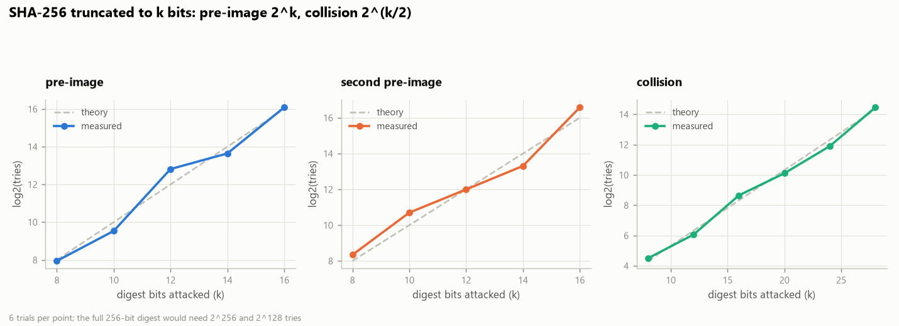

### Digital signatures

| Algorithm | Sign (median) | Verify (median) | Key generation | Signature | Public key |
|---|---|---|---|---|---|
| **Ed25519** (used) | **0.023 ms** | 0.065 ms | 0.022 ms | 64 B | 32 B |
| ECDSA P-256 | 0.018 ms | 0.053 ms | 0.011 ms | 72 B | 65 B |
| RSA-PSS-2048 | 0.396 ms | 0.025 ms | 27.3 ms | 256 B | 294 B |
| RSA-PSS-3072 | 1.220 ms | 0.044 ms | 30.3 ms | 384 B | 422 B |

Every published record stores its own **signing time** (measured on the teacher's device) and **verification
time** (measured by the server). Lab runs are stored in `data/cryptolab.db`.

## 6. Performance analysis

| Text: encryption time against plaintext length | Image: encryption time against image size |
|---|---|
| 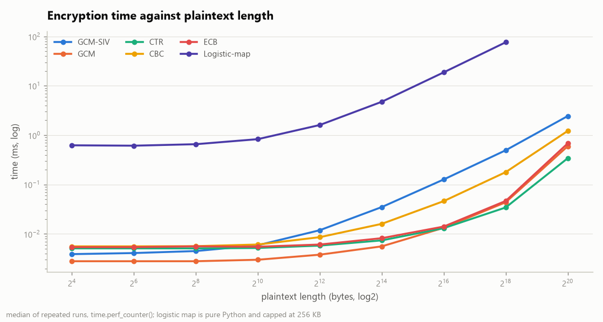 | 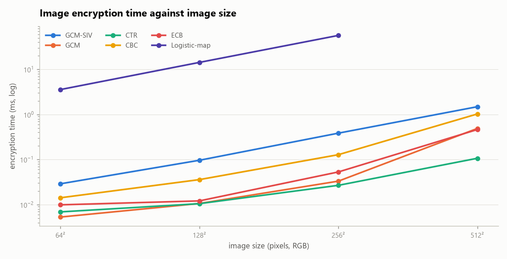 |

| At 1 MB | Encrypt | Decrypt |
|---|---|---|
| AES-256-CTR | 3,085 MB/s | 3,207 MB/s |
| AES-256-GCM | 1,606 MB/s | 1,640 MB/s |
| AES-256-CBC | 822 MB/s | 1,150 MB/s |
| AES-256-GCM-SIV | 407 MB/s | 454 MB/s |

- **Image:** a 256×256 RGB image encrypts in **0.38 ms** with GCM-SIV.
- **Hashes at 1 MB:** SHA-256 runs at 2,156 MB/s and SHA3-256 at 667 MB/s.
- **End to end:** a protected publish takes 11.2 ms (p50) against 4.9 ms for the plain baseline, so security
  costs about 6 ms per call on loopback (`python -m bench.bench --quick`).

## 7. Attacks and packet capture

All attacks come from the attacker device (127.0.0.66). Run them from the **Attack lab** page or a terminal:

| Command | Expected | Goal |
|---|---|---|
| `python -m attacks.tamper_cipher` | `400 integrity_failed` | Integrity |
| `python -m attacks.tamper_db` | Student sees *Signature invalid* | Integrity, authenticity |
| `python -m attacks.tamper_db --swap` | `500 record_integrity_failed` | Integrity |
| `python -m attacks.tamper_db --sheet` | Student sees *Image does not match the signed hash* | Integrity, authenticity |
| `python -m attacks.replay --last` | `409 replay_detected` | Replay resistance |
| `python -m attacks.replay --last --delay 35` | `409 stale_request` | Replay resistance |
| `python -m attacks.idor` | `403 forbidden` | Authorisation |
| `python -m attacks.forge_sig` | `400 bad_signature` | Authentication |
| `python -m attacks.revoked_key --revoke-first` | `403 key_revoked` | Key management |
| `python -m attacks.bad_login` | `401` then `429` | Authentication, availability |
| `python -m attacks.flood --seconds 10 --rate 50 --probe` | ~94 % `429`, student still served | Availability |

Undo helpers: `python -m attacks.tamper_db --restore` reverses the database tampering, and
`python scripts\setup_demo.py --rekey t104` issues a new key after a revocation.

**Captures.** `python -m analysis.experiments exp1` … `exp6` (or `all`) records a scripted scenario, analyses
it, and writes graphs and CSVs to `analysis/out/<capture>/`:

| Experiment | Shows |
|---|---|
| `exp1` | Plain JSON is readable on the wire; the protected body is ciphertext (4.4 vs 7.96 bits/byte) |
| `exp2` / `exp2_tls` | Over HTTP the password and JWT are visible; over TLS only sizes and timing |
| `exp3` | A replay at once and after 35 s, each matched to its audit row |
| `exp4` | A flood: rate spike, 429s, student latency near baseline |
| `exp5` | Five devices; a 403 for the friend's roll |
| `exp6` | An answer-sheet image on the wire: body entropy 7.995, no image header |

| Entropy, plain vs protected | Flood timeline |
|---|---|
| 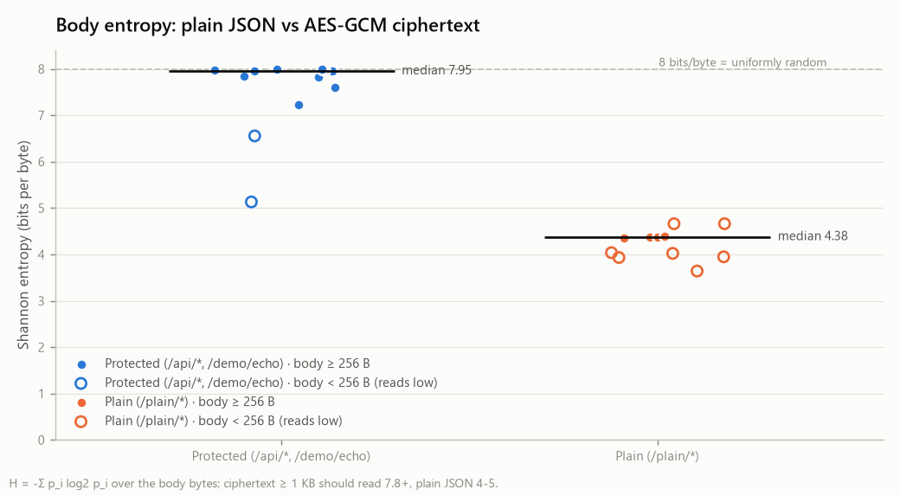 | 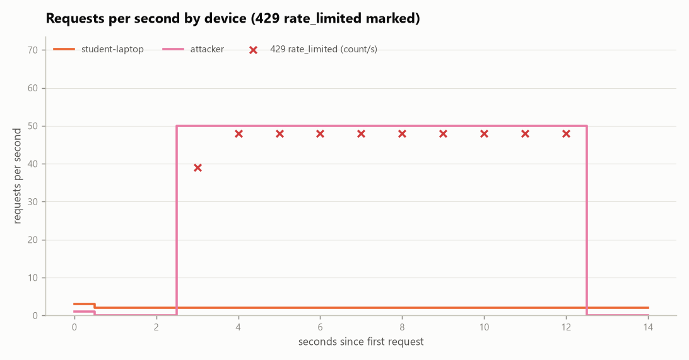 |

PCAP → SQLite (`python -m analysis.pcap_to_sqlite`) joins every flagged packet to the audit log by request ID.
PCAP → XML (`python -m analysis.pcap_to_xml`) exports PDML when tshark is installed, or a compact XML otherwise.

## 8. Requirements coverage

| Requirement | Where |
|---|---|
| Goals: confidentiality, integrity, authentication | Middleware, every lab |
| Text encrypt/decrypt, plaintext and ciphertext shown, ciphertext as JSON | Text encryption › Encrypt & decrypt |
| Confusion, diffusion, avalanche (50 % bit, ~100 % character) | Text encryption › Security analysis, Mode comparison |
| Encryption/decryption time and speed, graphs across plaintext lengths | Text encryption › Performance |
| Complete hash digest; pre-image, second pre-image, collision; generation time | Hashing |
| Signature generation and verification time, displayed and stored | Digital signatures; Publish / My marks |
| Image: RGB and encrypted pixels | Image encryption › Pixels |
| Image: NPCR, UACI, entropy, correlation coefficient, PSNR, MSE | Image encryption › Security metrics |
| Image: encryption/decryption time | Image encryption › Performance |
| Graphical analysis | Every lab, and Analysis report |
| Packet capture | Traffic lab, exp1–exp6 |

## 9. Related lab exercises

Where a feature corresponds to an exercise in the Information Security Lab manual (MIT Manipal, Dept. of ICT):

| Lab | Exercise | In this project |
|---|---|---|
| Lab 2 | Additional 1: encrypt with AES under different modes; plot and compare execution times | Text lab › Mode comparison and Performance |
| Lab 2 | Additional 4, 5: CBC with an IV; CTR with a nonce | AES-256-CBC and AES-256-CTR schemes |
| Lab 3 | Ex. 4, 5: RSA vs ECC performance; Diffie-Hellman with timing | Signatures lab; Key agreement; `bench/bench.py` |
| Lab 4 | Key management: generate, distribute, revoke, renew, store, audit | `middleware/keys/manager.py`, Keys page, audit log |
| Lab 5 | Ex. 1: djb2 hash; ex. 3: MD5 / SHA-1 / SHA-256 timing and collisions | Hashing › Lab 5 experiments |
| Lab 6 | Digital signatures; additional: the CIA triad with encryption, signatures and SHA | Signatures lab; the marks flow |
| Lab 8 | Intrusion detection on live traffic | Traffic lab: replay and flood flags joined to the audit log |

## 10. Tests

```powershell
python -m pytest -q        # 93 tests: crypto, guards, end-to-end flow, answer sheets, analysis metrics, portal API
cd web; npm test           # UI component tests
cd web; npm run typecheck  # TypeScript strict
```

Every test module runs on a throw-away database and its own keys. The metric tests check reference values:

- NIST SHA-256 and MD5 test vectors;
- the entropy of all 256 byte values (exactly 8);
- NPCR and UACI of independent random images;
- the Wu et al. critical values;
- PSNR of identical images (infinite).

## 11. Troubleshooting

| Symptom | Fix |
|---|---|
| `SecureMarks is not set up` or `schema is from an older version` | `python scripts\setup_demo.py --reset` |
| The portal says "not built yet" | `cd web; npm ci; npm run build` |
| The portal shows *Middleware offline* | Start it: `python scripts\run_demo.py --tap` |
| `--reset` says the database is in use | Close the server and portal windows first |
| Port 8000 or 8501 in use | Another copy is running: close it, or change the port and `SERVER_URL` in `.env` |
| `429` on your own clicks after the flood | Wait a few seconds for the token bucket to refill |
| "Your 15-minute token expired" | Sign in again |
| Teacher publish gives `403 key_revoked` | `python scripts\setup_demo.py --rekey t104` |
| *Hash chain broken* badge | `tamper_db --audit` was run; `--reset` gives a clean chain |
| No capture method | Install Wireshark + Npcap (loopback support), or use `--tap` |
| `ImportError: AESGCMSIV` | `pip install -U cryptography` (44 or newer) |

## 12. Project layout

```text
SecureMarks/
├── middleware/        the security layer (FastAPI)
│   ├── crypto/        aead (AES-GCM) · kex (X25519, HKDF, RSA-OAEP) · sign (Ed25519, RSA-PSS) · hashing · canonical
│   ├── guards/        concurrency, size, rate limit, replay, timeout
│   ├── auth/          Argon2id passwords · JWT · RBAC
│   ├── keys/          wrapped data keys, rotation, signing-key registry, revocation
│   ├── api/           auth, session, marks (+ answer sheets), admin, audit, plain baseline, demo
│   ├── secure.py      checks 4–9 and the encrypted response
│   ├── records.py     marks and answer sheets at rest (AES-256-GCM, AAD-bound)
│   └── audit.py       hash-chained audit log
├── sdk/client.py      SecureClient: device binding, handshake, envelopes, signing, verification
├── cryptolab/         analysis library: schemes, metrics, text, image, hashlab, signlab, perf, store, report
├── portal_api/        backend-for-frontend for the React portal (sessions, labs, ops)
├── web/               React 19 + TypeScript portal (Vite)
├── attacks/           eleven attack scripts with audit evidence
├── analysis/          capture, tap, analyser, plots, PCAP → SQLite / XML, experiments 1–6
├── bench/             efficiency benchmark
├── scripts/           setup_demo, run_demo, make_cert, backup_demo
├── config/            policies, devices, demo accounts
├── tests/             93 pytest tests
└── docs/figures/      generated graphs used in this README
```

Generated and git-ignored: `.env`, `secrets/`, `client_keys/`, `data/`, `captures/`, `analysis/out/`, `bench/out/`,
`cryptolab/out/`, `web/node_modules/`, `web/dist/`.

## 13. Credits and licence

- **Cryptography:** [pyca/cryptography](https://cryptography.io) (OpenSSL) and [argon2-cffi](https://argon2-cffi.readthedocs.io).
- **NPCR and UACI thresholds:** Y. Wu, J. P. Noonan, S. Agaian, *"NPCR and UACI Randomness Tests for Image
  Encryption"*, Cyber Journals: JSAT, 2011.
- **AES-GCM-SIV:** RFC 8452.
- **Sample photo:** the Grace Hopper portrait shipped with matplotlib (U.S. Navy, public domain).

Built as the final project for the Information Security Lab. Educational use; the logistic-map cipher is a
comparison baseline only and must not protect real data.
