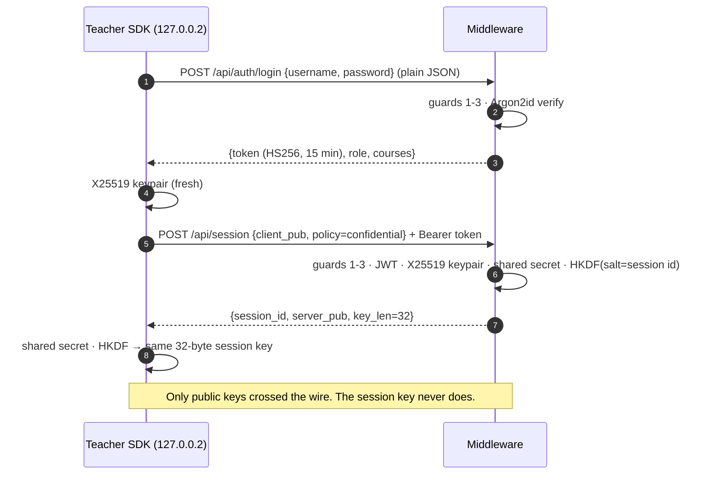
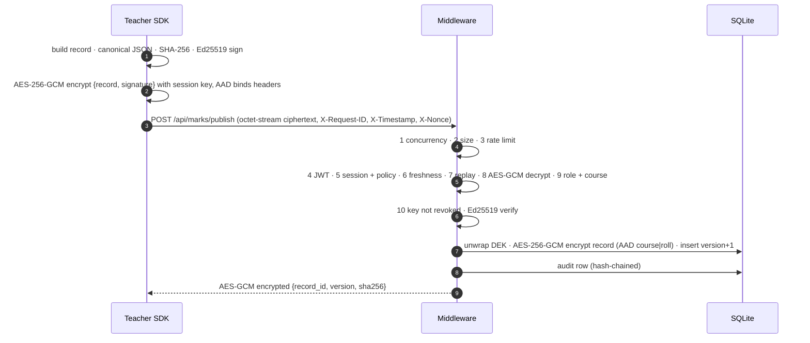
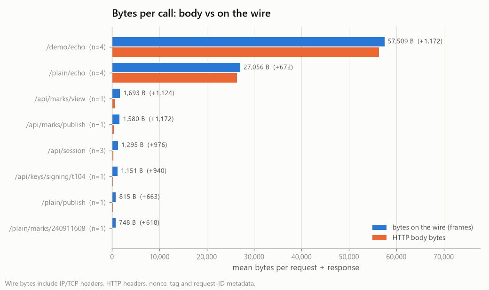
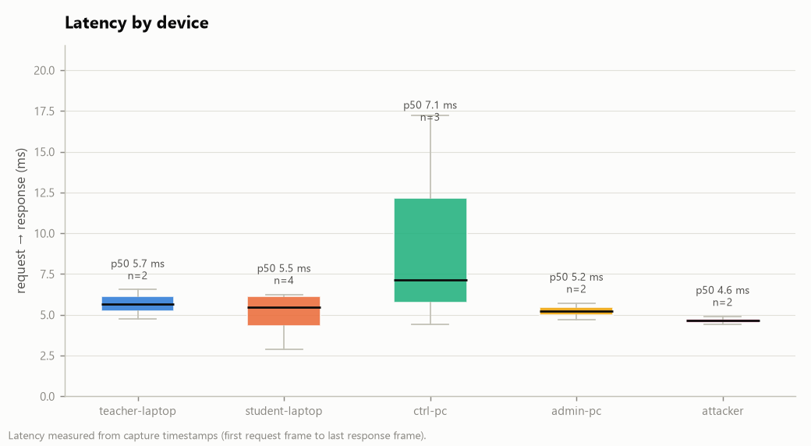
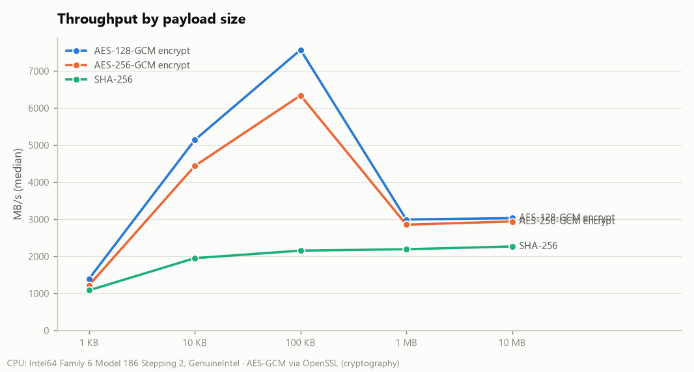
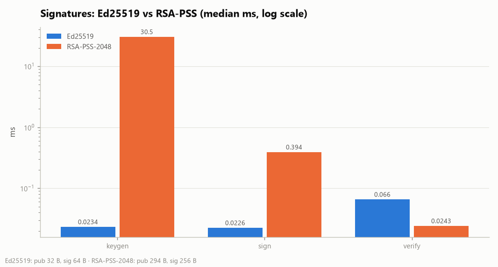
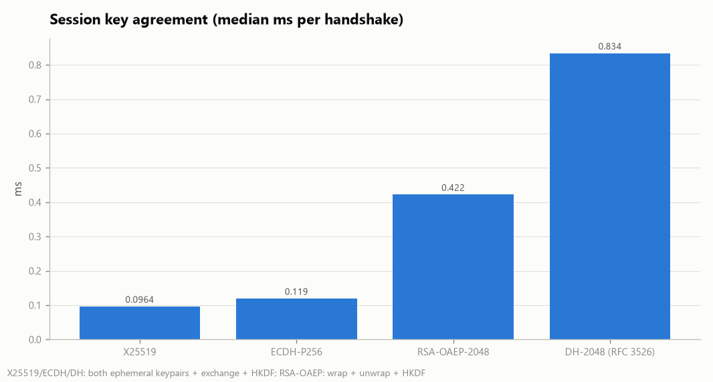
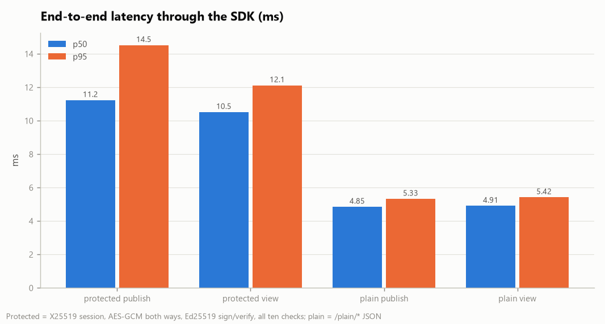

# SecureMarks: concepts, implementation and ISL compliance

**Project:** SecureMarks, a policy-driven security middleware with a student marks portal ·
**Group:** 2 members, V IT, section B · **ISL modules implemented:** 7 Traffic Analysis (Wireshark, PyShark) and
4 PCAP Analysis (PCAP → SQLite, PCAP → XML).

This report explains every security concept the project uses, **where exactly** it is implemented (file and line,
relative to the project root), how data moves through encryption, decryption, hashing, signing and verification,
and how each ISL instruction is met. All numbers come from the rehearsal run on the demo laptop
(Intel Core, Windows 11, Python 3.13); `README.md` explains how to reproduce them.

---

## Contents

1. [Summary](#1-summary)
2. [ISL instructions: how each one is met](#2-isl-instructions-how-each-one-is-met)
3. [System model: devices, data and keys](#3-system-model-devices-data-and-keys)
4. [The fundamental concepts, one by one](#4-the-fundamental-concepts-one-by-one)
5. [Where every encrypt, decrypt, sign and verify happens](#5-where-every-encrypt-decrypt-sign-and-verify-happens)
6. [End-to-end walkthroughs](#6-end-to-end-walkthroughs)
7. [Security goals: mechanism, test, result](#7-security-goals-mechanism-test-result)
8. [Module 7: traffic analysis with Wireshark and PyShark](#8-module-7-traffic-analysis-with-wireshark-and-pyshark)
9. [Module 4: PCAP analysis (PCAP → SQLite, PCAP → XML)](#9-module-4-pcap-analysis-pcap--sqlite-pcap--xml)
10. [Efficiency analysis](#10-efficiency-analysis)
11. [Limitations and future work](#11-limitations-and-future-work)
12. [Appendix: error codes and file map](#12-appendix-error-codes-and-file-map)

---

## 1. Summary

SecureMarks separates *what the application wants* from *how it is protected*. The portal only states that marks
are "confidential"; the middleware turns that word into concrete decisions read from `config/policies.yaml`:
X25519 key agreement, AES-256-GCM in transit and at rest, Ed25519 signatures on every marks record, a 30-second
replay window and a token-bucket rate limit. Every request passes ten checks in a fixed order, every outcome is
written to a hash-chained audit log, and a packet capture analysed with PyShark proves on the wire what the
inspector shows on screen.

| What | How much |
|---|---|
| Security goals covered | Confidentiality, integrity, authentication, accountability, availability (the five ISL goals) plus authorisation and replay resistance |
| Checks per protected request | 10, in a fixed order, each mapped to one error code |
| Attacks in the security analysis | 8 scripts (10 variants), each refused with its expected code and audit row |
| Simulated devices | 5, each with its own loopback IP, login, session key and traffic |
| ISL modules implemented | 2 (Traffic Analysis, PCAP Analysis); Web Application Pentesting is exercised by the attack lab |
| Automated tests | 39, all passing |

---

## 2. ISL instructions: how each one is met

| ISL instruction | How SecureMarks meets it | Evidence (where to look) |
|---|---|---|
| Incorporate at least one module from the list, as a real component | **Module 7, Traffic Analysis:** capture with `dumpcap` on Npcap's loopback adapter and analyse with **PyShark** (`pyshark.FileCapture`). **Module 4, PCAP Analysis:** every packet and HTTP message loaded into SQLite and joined with the audit log; PCAP exported to XML | `analysis/capture.py:34-35`, `analysis/packets.py:100`, `analysis/analyze.py`, `analysis/pcap_to_sqlite.py:81-101`, `analysis/pcap_to_xml.py:34` |
| "Actually implemented, not merely mentioned in the abstract" | Both modules run end to end on saved captures and produce CSVs, graphs, a SQLite database and an XML file | `analysis/out/<capture>/` (messages, flows, flags, four graphs, `audit_join.csv`), `data/capture_<name>.db`, `analysis/out/<name>.xml` |
| Multiple security goals | Seven goals, each with a mechanism, a security test and an efficiency metric (section 7) | Attack lab, inspector, audit log, Benchmarks page goal matrix |
| Security analysis | Eight attack scripts against the running system: ciphertext tampering, database tampering, row swapping, replay (immediate and late), IDOR, forged signature, revoked key, password guessing, flood | `attacks/*.py`; each prints the expected vs actual code, the audit row and the server trace |
| Efficiency analysis | Benchmark of every primitive across payload sizes, per-check costs, end-to-end latency, and wire overhead and latency measured from the captures | `bench/bench.py` → `bench/out/*.png`; `analysis/out/*/overhead_bytes.png`, `latency_by_device.png` |
| At least 2 devices or a simulation | Five simulated devices with their own loopback IPs (127.0.0.2-.5 and .66), each with its own login, session key and traffic | `config/devices.yaml`; `sdk/client.py:112` binds each client to its device IP; exp5 capture shows five hosts |
| Members from the same batch; max 3 members | Two members, both V IT, section B | Synopsis cover |
| 4-member groups: CIAAA + text, images, audio, video | Not applicable to a 2-member group. All five CIAAA goals are nevertheless covered for text (marks). Encrypted answer-sheet images are a P2 stretch: the same AES-GCM + Ed25519 path carries any bytes | Section 7 |
| Synopsis by 25 August 2026 | Administrative item, handled outside this codebase | — |

**Related list topic:** the attack lab is a small *web application penetration test* of our own API (module 5):
authorisation bypass (IDOR), credential guessing with rate-limit evasion, request replay, ciphertext and database
tampering, and application-layer flooding. The formal claim remains modules 7 and 4.

---

## 3. System model: devices, data and keys

### 3.1 Devices and processes

| Device | Address | Role in the demo |
|---|---|---|
| teacher-laptop | 127.0.0.2 | t104 signs and publishes IT301 marks |
| student-laptop | 127.0.0.3 | s608 and s612 view their own marks and verify signatures |
| ctrl-pc | 127.0.0.4 | Exam controller verifies records and reads the audit log; never sees marks |
| admin-pc | 127.0.0.5 | Rotates data keys, revokes signing keys |
| attacker | 127.0.0.66 | Replays, tampers, floods, uses stolen tokens |
| server | 127.0.0.1:8000 | The middleware (FastAPI, one Uvicorn worker) |

Device separation is real at the socket level: `SecureClient` creates its HTTP transport with
`local_address=device_ip` (`sdk/client.py:112-133`), so the server, the audit log and the capture all see the
device's own source address. If a laptop cannot bind 127.0.0.x, the `X-Device` header is the fallback label.

### 3.2 What is protected

A **marks record** is a JSON object with exactly seven fields: `course`, `roll_no`, `midsem`, `endsem`, `total`,
`teacher`, `published_at`. Its **canonical form**, the exact bytes that are hashed, signed and stored, is

```python
json.dumps(record, sort_keys=True, separators=(",", ":")).encode()   # middleware/crypto/canonical.py:17
```

Canonicalisation matters: the teacher, the server, the student and the exam controller must all hash *the same
bytes*, or a valid signature would fail to verify.

### 3.3 Key inventory

Every key has one job (key separation), and only the teacher's own device ever holds the teacher's private key.

| Key | Algorithm | Created in | Stored | Used for |
|---|---|---|---|---|
| Master key (KEK) | 32 random bytes, AES-256-GCM | `middleware/keys/manager.py:57` | `secrets/master.key` only (never in the DB) | Wrapping and unwrapping data keys |
| Data key (DEK) v1, v2… | AES-256-GCM | `middleware/keys/manager.py:64` | DB `data_keys`, **wrapped** by the KEK (`:65`) | Encrypting marks at rest |
| Session key | 32 B (confidential) or 16 B (normal), HKDF-SHA256 | Both sides: `sdk/client.py:235`, `middleware/api/session.py:69` | Server memory (15 min), client memory | Encrypting each request and response body |
| Teacher signing key | Ed25519 (RSA-PSS-2048 for `legacy-rsa`) | `scripts/setup_demo.py:73-81` | Private: `client_keys/t104_ed25519.pem`, PKCS8 encrypted with t104's password. Public: DB `signing_keys` | Signing every published record |
| Server RSA key (P1) | RSA-2048, OAEP-SHA256 | `scripts/setup_demo.py` | `secrets/server_rsa.pem` | Unwrapping the session secret in `legacy-rsa` sessions |
| JWT secret | 64 hex chars, HS256 | `scripts/setup_demo.py` (`write_env`) | `.env` | Signing and checking 15-minute login tokens |
| Password hashes | Argon2id | `scripts/setup_demo.py:113` | DB `users.pw_hash` | Verifying logins |
| TLS key and certificate (P1) | ECDSA P-256, SAN IP:127.0.0.1 | `scripts/make_cert.py` | `secrets/server.key`, `secrets/server.crt` | The HTTPS server for experiment 2 |

---

## 4. The fundamental concepts, one by one

Each subsection gives the idea, why it is needed here, exactly where it is implemented, and what proves it works.

### 4.1 Authenticated encryption: AES-GCM (confidentiality + integrity)

**Idea.** AES in Galois/Counter Mode encrypts and authenticates in one step. Inputs: a key, a fresh 12-byte
**nonce**, the plaintext and optional **associated data (AAD)**. Output: ciphertext plus a 16-byte **tag**. Changing a
single bit of the ciphertext, the tag, the nonce or the AAD makes decryption fail with `InvalidTag`, so nobody can
read the data, and nobody can change it undetected.

**Implementation.** `middleware/crypto/aead.py:31` (`encrypt`) and `:37` (`decrypt`), thin wrappers over
`cryptography`'s `AESGCM`. A new random nonce is drawn for every message (`os.urandom(12)`), so a nonce is never
reused with the same key; `tests/test_crypto.py::test_nonces_are_fresh` checks 200 in a row.

**Where AES-GCM is used (three different keys, three different jobs):**

| Use | Key | AAD | Encrypt | Decrypt |
|---|---|---|---|---|
| Request bodies in transit | Session key | `METHOD\|path\|session_id\|request_id\|timestamp\|policy` | `sdk/client.py:266` | `middleware/secure.py:146` |
| Response bodies in transit | Session key | `resp\|request_id` | `middleware/secure.py:173` | `sdk/client.py:289` |
| Marks at rest | Active data key | `marks\|course\|roll_no` | `middleware/records.py:29` | `middleware/records.py:62` |
| Data keys in the database | Master key | `dek\|v<version>` | `middleware/keys/manager.py:65` | `middleware/keys/manager.py:75` |

**Why the AAD matters.** The AAD is authenticated but not encrypted. Binding the request headers into it means an
attacker cannot move a valid ciphertext to another path, session or request ID, or change its timestamp, without
breaking the tag. Binding `course|roll_no` at rest means a ciphertext copied into another student's row no longer
decrypts (the `tamper_db --swap` attack → `500 record_integrity_failed`).

**Proof.** `attacks/tamper_cipher.py` flips one bit in flight → `400 integrity_failed`, and the request ID is **not**
added to the seen set, so forged garbage cannot fill it (`middleware/secure.py:149` runs only after a successful
decrypt). On the wire, protected bodies of 1 KB or more measured **7.96 bits/byte** of entropy, against **4.39** for
the same data as plain JSON (exp1).

### 4.2 Cryptographic hashing: SHA-256 (integrity, fingerprints, chaining)

**Idea.** A hash maps any input to a fixed 256-bit digest. Finding two inputs with the same digest, or changing an
input while keeping its digest, is infeasible. Changing one character flips about half of the output bits (the
avalanche effect shown in the Crypto playground).

**Where SHA-256 is used:**

| Use | Where |
|---|---|
| Digest of the canonical record (what gets signed) | Teacher: `sdk/client.py:322`; server: `middleware/api/marks.py:48` |
| Recomputed by the student and compared with the stored digest | `sdk/client.py:359` |
| Recomputed by the exam controller's verify | `middleware/api/marks.py:120` |
| Stored per record (`marks.sha256`) | `middleware/records.py:25-38` |
| Public-key fingerprints (first 8 bytes of SHA-256) | `middleware/crypto/sign.py:78` |
| Audit hash chain | `middleware/audit.py:55` |
| Inside HKDF (HKDF-SHA256) and inside Ed25519 / RSA-PSS | `middleware/crypto/kex.py:34`, `sign.py` |

### 4.3 Digital signatures: Ed25519 (authentication, integrity, non-repudiation)

**Idea.** The teacher signs with a **private** key that never leaves the teacher's device; anyone holding the
**public** key can verify. A valid signature proves the record came from that key and was not changed since, even if
the server or its database is later compromised. AES-GCM alone cannot do this: the server holds the AES keys, so it
could rewrite records undetected. The signature is the end-to-end proof.

**Why Ed25519 over RSA.** 32-byte public keys and 64-byte signatures (RSA-2048: 294 B and 256 B), about 17× faster
signing and ~1,300× faster key generation on this laptop, around 128-bit security, and deterministic signing, so a
bad random number generator cannot leak the key. RSA-PSS-2048 is kept as the `legacy-rsa` policy and in the
benchmark for the comparison.

**Lifecycle in the code:**

| Step | Where |
|---|---|
| Keypair generated; private key saved as PKCS8 PEM **encrypted with the teacher's password**; public key registered | `scripts/setup_demo.py:73-81` |
| Private key unlocked on the teacher's device at sign-in | `portal/components/common.py` (`login`), `sdk/client.py:102` |
| **Sign** the SHA-256 of the canonical record | `sdk/client.py:324` → `middleware/crypto/sign.py:62` |
| **Verify** on publish (server) | `middleware/api/marks.py:67` |
| **Verify** on view (student, end to end) | `sdk/client.py:367` |
| **Verify** on audit (exam controller, server-side, no marks returned) | `middleware/api/marks.py:129` |
| Revocation blocks further publishes | `middleware/keys/manager.py:124-131`, checked at `middleware/api/marks.py:64` |

**Proof.** `attacks/forge_sig.py` uses a stolen t104 token but signs with the attacker's own key: token, session and
AES-GCM all pass, and only the signature check stops it (`400 bad_signature`). `attacks/tamper_db.py` re-encrypts an
edited record with the real data key (a malicious administrator), and the student's page turns red: *Signature
invalid*.

### 4.4 Key agreement: X25519 + HKDF-SHA256 (fresh session keys)

**Idea.** Ed25519 cannot encrypt, so session keys come from X25519, Diffie-Hellman on the same Curve25519 family.
Client and server each generate a **fresh** keypair per session, exchange only the public halves, and each computes
the same shared secret; an eavesdropper who sees both public keys cannot. HKDF turns the raw shared secret into a
uniformly random AES key of the policy's length, using the session ID as salt and `securemarks/v1/session` as
context.

| Step | Client (SDK) | Server |
|---|---|---|
| Fresh keypair | `sdk/client.py:221` | `middleware/api/session.py:52` |
| Shared secret | `sdk/client.py:234` | `middleware/api/session.py:53` |
| HKDF → session key | `sdk/client.py:235` | `middleware/api/session.py:69` |
| Session stored (15 min, in memory) | `self.sessions[policy]` | `middleware/sessions.py:35` |

**Comparison policy (P1).** `legacy-rsa` sessions use RSA-OAEP-2048: the client wraps a random 32-byte secret with
the server's public RSA key (`sdk/client.py:216`), the server unwraps it (`middleware/api/session.py:61`), and the
same HKDF step follows.

**Proof.** The playground's X25519 tab shows Alice = Bob ≠ Eve; `tests/test_crypto.py::test_x25519_both_sides_derive_equal_keys`
checks it; a capture of `POST /api/session` shows two public keys and no session key.

### 4.5 Key management: envelope encryption, rotation, expiry, revocation

**Envelope encryption.** Marks are encrypted with a data key; the data key is stored only wrapped by the master
key; the master key lives in a file outside the database. Stealing the database alone reveals nothing.

| Operation | Where | Behaviour |
|---|---|---|
| Create data key | `middleware/keys/manager.py:63` | Random 32 B, wrapped with AAD `dek|v<n>`, expires in 180 days |
| Encrypt always with the active key | `middleware/keys/manager.py:78` | Refuses an expired key: it becomes decrypt-only |
| Decrypt with the record's own key | `middleware/keys/manager.py:87` | Refuses a revoked key |
| Rotate (P1) | `middleware/keys/manager.py:96` | New version active, old one retired; old records still open |
| Revoke a signing key | `middleware/keys/manager.py:124` | Further publishes → `403 key_revoked`; records signed before `revoked_at` still verify, and the student view shows the date |

### 4.6 Password storage: Argon2id

Passwords are stored only as Argon2id hashes (`middleware/auth/passwords.py:13`). Argon2id is deliberately slow and
memory-hard (33 ms to hash, 54 ms to verify here), which makes offline guessing expensive. Login verifies at
`middleware/api/auth.py:35`. For an unknown username a dummy hash is still verified (`passwords.py:9-10`), so response
time does not reveal which usernames exist.

### 4.7 Authentication tokens: JWT (HS256, 15 minutes)

After a correct password the server issues a JWT signed with HMAC-SHA256 (`middleware/auth/tokens.py:16`, called at
`middleware/api/auth.py:43`) carrying `sub`, `role`, `roll_no`, `courses`, `exp` and a unique `jti`. Every protected
call checks it first (`middleware/secure.py:88`): a bad signature or an expired token → `401 auth_failed`. The rate
limiter keys its buckets on the token's subject (`middleware/auth/tokens.py:39`), so a client cannot escape its own
bucket by presenting a stale token.

### 4.8 Authorisation: roles and ownership (least privilege)

Two layers, both in step 9 (`middleware/secure.py:161`):

- **Role**: each route lists the roles allowed (`middleware/auth/rbac.py:21`). A student calling publish → `403`.
- **Ownership**: a teacher may publish only for courses they teach (`rbac.py:27`, via
  `middleware/api/marks.py:23`); a student may view only the roll number in their own token (`rbac.py:33`, via
  `marks.py:32`). The friend's-marks attempt is audited as `idor_blocked`.

The exam controller can verify and audit but receives only booleans and metadata, never marks
(`middleware/api/marks.py:107-147`).

### 4.9 Replay resistance: request ID, timestamp, seen set

Every protected request carries a fresh `X-Request-ID` (UUID4) and `X-Timestamp`, and **both are inside the AAD**
(`middleware/secure.py:48`), so they cannot be edited without breaking decryption. The server then:

1. rejects a timestamp outside the policy window (30 s for confidential) → `409 stale_request`
   (`middleware/secure.py:130`, `middleware/guards/replay.py:14`);
2. rejects a request ID it has already accepted → `409 replay_detected` (`middleware/secure.py:135`);
3. stores the ID as seen only **after** a successful decrypt, atomically, for twice the window
   (`middleware/secure.py:149`, `middleware/guards/replay.py:39`).

**Proof.** `attacks/replay.py --last` resends the teacher's captured publish byte for byte from 127.0.0.66 →
`409 replay_detected`; with `--delay 35` → `409 stale_request`. The PCAP → SQLite join matches each replay to its own
audit row (section 9).

### 4.10 Availability: four guards in front of everything

| Guard | Where | Rule | Error |
|---|---|---|---|
| Concurrency cap | `middleware/guards/concurrency.py:22` | 20 requests in flight; the 21st is refused at once, not queued | `503 busy` |
| Size cap | `middleware/guards/size.py:35,50` | Policy maximum (512 KB confidential), never above 5 MB; chunked bodies are counted | `413 too_large` |
| Token bucket | `middleware/guards/ratelimit.py:57-76` | Per user and policy (10 tokens, 2/s for confidential); per IP before login (5 tokens, 0.5/s) | `429 rate_limited` + `Retry-After` |
| Handler timeout | `middleware/guards/timeout.py:14` | Crypto-heavy handlers run in a thread pool under a 10 s limit | `504 timeout` |

The guards are Starlette middleware added in reverse order (`middleware/main.py:90-92`), so they run 1 → 2 → 3 before
any authentication or cryptography happens: a flood costs the server almost nothing.

**Proof.** exp4: 500 valid encrypted requests in 10 s with a stolen s612 token; 471 refused with 429, while s608's
probe got **15/15** answers with median latency **7.8 ms before, 7.3 ms during** and 7.2 ms after the flood.

### 4.11 Accountability: hash-chained audit log and traces

Every decision (allowed, denied or error) writes one `audit_log` row with request ID, actor, role, source IP, device,
action, outcome, code and detail (`middleware/state.py`, `audit_outcome`). Rows are **hash-chained**:

```text
entry_hash = SHA-256(prev_hash + canonical(entry))          # middleware/audit.py:55
```

Editing or deleting any row breaks every later hash; `audit/list` recomputes the whole chain and returns `chain_ok`
(`middleware/audit.py:95`). In demo mode every check is also a **trace event** (`middleware/trace.py`), shown in the
inspector and printed on the server console. Plaintext marks, passwords and keys are never logged; keys appear only
as their first and last 4 bytes.

**Proof.** Every attack in section 7 has an audit row with its request ID; the capture-to-audit join matched 100 % of
flagged packets (exp3 2/2, exp4 500/500); `tamper_db --audit` rewrites one row and the badge turns to *hash chain
broken at entry #n*.

### 4.12 Policy-driven security

`config/policies.yaml` defines `confidential` (AES-256-GCM, Ed25519 required, 512 KB, 10/2 s, 30 s), `normal`
(AES-128-GCM, no signature, 5 MB, 30/10 s, 60 s) and `legacy-rsa`. They are validated at start-up with Pydantic
(`middleware/policy/engine.py:24-56`): an unknown cipher or a missing field stops the server. Each route declares its
minimum policy, and a weaker session gets `403 policy_too_weak` (`middleware/secure.py:124`). This is the "app says
confidential, middleware decides how" idea in code.

### 4.13 Fail-closed error handling

Every failed check raises one `ApiError` (`middleware/errors.py`), caught exactly once
(`middleware/main.py:32-77`), audited, and returned as plain JSON `{"error", "detail", "request_id"}`. There are no
silent fallbacks: a check that cannot run refuses the request.

### 4.14 Entropy as evidence of confidentiality

Shannon entropy of a body, in bits per byte (`middleware/crypto/hashing.py:22`, used at `analysis/analyze.py:86`):

$$H = -\sum_{i=0}^{255} p_i \log_2 p_i$$

where $p_i$ is the share of byte value $i$. English-like JSON uses few distinct bytes (about 4–5 bits/byte);
good ciphertext is indistinguishable from random (close to 8). Bodies under 256 B read low because a small sample
cannot contain all 256 values, so they are reported separately.

---

## 5. Where every encrypt, decrypt, sign and verify happens

One table for the whole system, in the order the operations occur.

| # | Operation | Who / where | Key | Input → output |
|---|---|---|---|---|
| 1 | Argon2id hash | Setup: `scripts/setup_demo.py:113` | — | password → `users.pw_hash` |
| 2 | Generate + encrypt private key | Setup: `scripts/setup_demo.py:75-76` | teacher's password | Ed25519 private key → encrypted PKCS8 PEM |
| 3 | Wrap data key | Setup / rotate: `middleware/keys/manager.py:65` | KEK | DEK → `data_keys.wrapped_key` |
| 4 | Argon2id verify | Login: `middleware/api/auth.py:35` | — | password vs hash → yes/no |
| 5 | JWT sign | Login: `middleware/api/auth.py:43` | JWT secret | claims → token |
| 6 | X25519 + HKDF | Handshake: `sdk/client.py:221-235`, `middleware/api/session.py:52-69` | ephemeral keypairs | public keys → shared secret → session key |
| 7 | SHA-256 | Teacher: `sdk/client.py:322` | — | canonical record → digest |
| 8 | **Ed25519 sign** | Teacher: `sdk/client.py:324` | teacher private key | digest → 64-byte signature |
| 9 | **AES-GCM encrypt (request)** | Teacher: `sdk/client.py:266` | session key, AAD = method\|path\|session\|request-id\|timestamp\|policy | JSON payload → ciphertext + tag |
| 10 | JWT verify | Server: `middleware/secure.py:88` | JWT secret | token → user, role, roll, courses |
| 11 | **AES-GCM decrypt (request)** | Server: `middleware/secure.py:146` | session key, same AAD | ciphertext → payload, or `400 integrity_failed` |
| 12 | SHA-256 + **Ed25519 verify** | Server: `middleware/api/marks.py:48,67` | teacher public key | signature over digest → valid, or `400 bad_signature` |
| 13 | Unwrap data key | Server: `middleware/keys/manager.py:75` | KEK | wrapped DEK → DEK |
| 14 | **AES-GCM encrypt (at rest)** | Server: `middleware/records.py:29` | DEK, AAD = marks\|course\|roll | canonical record → stored ciphertext |
| 15 | **AES-GCM encrypt (response)** | Server: `middleware/secure.py:173` | session key, AAD = resp\|request-id | result JSON → ciphertext |
| 16 | SHA-256 audit chain | Server: `middleware/audit.py:55` | — | previous hash + entry → entry hash |
| 17 | **AES-GCM decrypt (response)** | Client: `sdk/client.py:289` | session key | ciphertext → result JSON |
| 18 | **AES-GCM decrypt (at rest)** | Server, on view: `middleware/records.py:62` | DEK | stored ciphertext → record, or `500 record_integrity_failed` |
| 19 | SHA-256 recompute + **Ed25519 verify** | Student: `sdk/client.py:359,367` | teacher public key | record → *Verified* or *Signature invalid* |
| 20 | SHA-256 recompute + **Ed25519 verify** | Exam controller via server: `middleware/api/marks.py:120,129` | teacher public key | record → booleans only |

---

## 6. End-to-end walkthroughs

### 6.1 Login and session handshake



Over plain HTTP the login body is readable in the capture (experiment 2: the XML export shows
`{"username":"t104","password":"teach@104"}`). That is a deliberate finding: it is why the TLS run exists (P1), and
why everything after login is encrypted at the application layer regardless.

### 6.2 Teacher publishes marks



What crosses the wire for this request (`sdk/client.py:272-274`):

| Part | Value |
|---|---|
| Method, type | `POST`, `Content-Type: application/octet-stream` |
| `Authorization` | `Bearer <JWT>` |
| `X-Session-ID` | from the handshake |
| `X-Request-ID` | UUID4, new for every request |
| `X-Timestamp` | Unix seconds |
| `X-Nonce` | base64 of the 12-byte AES-GCM nonce |
| `X-Policy` | `confidential` |
| `X-Device` | `teacher-laptop` |
| Body | raw ciphertext + 16-byte tag (raw bytes, not base64, so entropy measurements are honest) |

### 6.3 Student views marks

The server finds the latest version of each course for the roll in the **token** (never the one asked for, unless
equal), unwraps the record's data key, decrypts with AAD `marks|course|roll`, and returns the record with its
signature, encrypted under the session key. The student's SDK decrypts the response, recomputes the SHA-256 of
the canonical record, fetches the teacher's public key by fingerprint and verifies the Ed25519 signature
(`sdk/client.py:351-377`). Only then does the page show *Verified · signed by t104*.

### 6.4 Exam controller verifies a record

The controller sends only a record ID (policy `normal`). The server decrypts the record internally, recomputes the
hash, verifies the signature and returns `sha256_ok`, `signature_ok`, the signer, the key status and whether the record
was signed before any revocation, but **no marks** (`middleware/api/marks.py:107-147`). This separates *checking*
from *seeing*: least privilege for an auditor.

---

## 7. Security goals: mechanism, test, result

| Goal | Mechanism (where) | Security test | Observed result | Efficiency metric (measured) |
|---|---|---|---|---|
| **Confidentiality** | X25519 + AES-GCM in transit (`secure.py:146,173`); AES-256-GCM at rest (`records.py:29`); wrapped DEKs (`manager.py:65`) | exp1: same marks to `/plain/*` and `/api/*` | Plain marks readable in the capture, protected bodies random; entropy 4.39 vs **7.96** bits/byte (≥ 1 KB) | AES-256-GCM 2,856 MB/s @ 1 MB; +765 B on the wire per publish (1,580 vs 815 B) |
| **Integrity** | GCM tag + AAD; SHA-256 record hash; Ed25519 signature | `tamper_cipher`; `tamper_db`; `tamper_db --swap` | `400 integrity_failed`; student sees *Signature invalid*, controller verify `sha256_ok=false, signature_ok=false`; `500 record_integrity_failed` | SHA-256 2,194 MB/s; Ed25519 verify 0.066 ms |
| **Authentication** | Argon2id (`auth.py:35`); 15-min JWT (`secure.py:88`); Ed25519 (`marks.py:67`); key revocation (`marks.py:64`) | `bad_login`, expired token test, `forge_sig`, `revoked_key` | `401` then `429`; `401 auth_failed`; `400 bad_signature`; `403 key_revoked` | Argon2id 33/54 ms; Ed25519 sign 0.023 ms vs RSA-2048 0.39 ms; X25519 0.096 ms vs RSA-OAEP 0.42 ms |
| **Accountability** | Hash-chained audit log (`audit.py:55`), traces | Every attack; `tamper_db --audit` | Every refused request has an audit row with its request ID; 100 % of flagged packets joined; chain break detected | Audit write 683 µs per request |
| **Availability** | Concurrency, size, token bucket, timeout (`main.py:90-92`) | `flood --probe` (exp4); 6 MB body test | 471/500 flood requests → 429; student 15/15 OK, p50 7.8 → 7.3 ms; `413 too_large` | Token bucket 0.4 µs per request |
| **Authorisation** (extra) | Role + ownership (`rbac.py`, `secure.py:161`) | `idor`; teacher publishing CS201 | `403 forbidden`, audited `idor_blocked` | RBAC 0.2 µs |
| **Replay resistance** (extra) | Request ID + timestamp in AAD; seen set (`secure.py:130-149`) | `replay --last`, `--delay 35` | `409 replay_detected`; `409 stale_request` | Seen-set lookup 0.2 µs with 10,000 IDs |

All attack results above were observed in the rehearsal run; `tests/test_guards.py` and `tests/test_flow.py`
re-check them on every `pytest` run.

---

## 8. Module 7: traffic analysis with Wireshark and PyShark

### 8.1 Capture

`analysis/capture.py` runs `dumpcap -i \Device\NPF_Loopback -f "tcp port 8000 or tcp port 8443" -w
captures\<name>.pcapng` (`:34-35`) under a small supervisor that stops it cleanly with CTRL_BREAK (`:198`), so the
last packets are flushed. PyShark is never run inside Streamlit (asyncio conflicts on Windows); analysis is always a
separate process on a saved file. On laptops without Npcap, `analysis/tap.py` relays the traffic byte for byte and
records each chunk as an IPv4/TCP frame on a loopback-type interface, readable by Wireshark and PyShark alike.

### 8.2 Analysis pipeline (`analysis/analyze.py`)

1. **Read** every packet on the server ports with `pyshark.FileCapture(..., keep_packets=False)`
   (`analysis/packets.py:100`); a second pass with `tcp.analysis.retransmission` counts retransmissions per stream
   (`:124`). Without tshark, the same fields come from the built-in pcapng reader (`:139`).
2. **Reassemble HTTP** from raw TCP payloads (`analysis/httpparse.py:68,151`): group by stream and direction, sort by
   sequence number, drop bytes already covered (retransmissions), split by headers and `Content-Length`.
3. **Pair** the n-th request with the n-th response per stream (`httpparse.py:177`).
4. **Measure** per request: latency, device, status, error code, request ID, body bytes, wire bytes, entropy
   (`analyze.py:57`).
5. **Flag** replays and floods (`analyze.py:104`) and **cross-check** each flag with `audit_log` (`analyze.py:134`).

### 8.3 Results from the five experiments

| Capture | Packets | Requests | Devices seen | Statuses | Key finding |
|---|---|---|---|---|---|
| exp1_plain_vs_protected | 124 | 16 | teacher, student | 16 × 200 | Entropy plain 4.39 vs protected 7.96 bits/byte; marks readable only on `/plain/*` |
| exp2_http | 47 | 8 | teacher, student | 8 × 200 | Login password and JWT readable over HTTP; protected bodies still unreadable |
| exp3_replay | 56 | 5 | teacher, attacker | 3 × 200, 2 × 409 | Same request ID three times: original 200, replay 409 `replay_detected`, late replay 409 `stale_request` |
| exp4_flood | 2,809 | 532 | attacker (501), student (31) | 471 × 429, 61 × 200 | 500 flood flags, all matched in the audit log; student latency unchanged |
| exp5_devices | 114 | 13 | **all five** | 11 × 200, 2 × 403 | Five separate hosts; both friend's-roll attempts refused |

The four graphs per capture (`entropy_plain_vs_protected.png`, `overhead_bytes.png`, `latency_by_device.png`,
`rate_timeline.png`) are explained in README section 8. The ones that carry the argument:







---

## 9. Module 4: PCAP analysis (PCAP → SQLite, PCAP → XML)

### 9.1 PCAP → SQLite

`analysis/pcap_to_sqlite.py` writes `data/capture_<name>.db` with two tables:

- `packets(frame, ts, src, dst, sport, dport, stream, length, payload_len, retrans)`: every TCP packet (`:81`);
- `http_messages(ts, resp_ts, latency_ms, src_ip, device, method, path, status, error_code, request_id, …, flag)`:
  every request row (`:86`).

It then attaches the application database (`:101`) and joins captured traffic with the server's own decisions:

```sql
ATTACH 'data/securemarks.db' AS app;
SELECT m.ts, m.device, m.request_id, m.status, a.action, a.outcome, a.code
FROM http_messages m
LEFT JOIN app.audit_log a ON a.request_id = m.request_id
WHERE m.flag IN ('replay', 'flood')
ORDER BY m.ts;
```

Because a replayed request ID legitimately has two audit rows (the original publish and the refused replay), a
refined query picks the audit row nearest in time with a window function (`ROW_NUMBER() OVER (PARTITION BY message
ORDER BY |Δt|)`) and saves `audit_join.csv`. Results: **exp3** replay → `marks_publish denied replay_detected`, late
replay → `marks_publish denied stale_request` (2/2 matched); **exp4** 500/500 flood messages matched.

This join is the accountability argument made concrete: what the network saw and what the server decided are two
independent records, and they agree.

### 9.2 PCAP → XML

`analysis/pcap_to_xml.py` runs `tshark -r <pcap> -T pdml` when tshark is installed (`:34`); otherwise it writes a
compact XML of every packet and HTTP message (headers, JSON bodies as text, ciphertext as hex). In
`analysis/out/exp2_http.xml` the login body appears in clear text, the experiment-2 finding.

---

## 10. Efficiency analysis

`bench/bench.py --quick`; medians with warm-up, `time.perf_counter()`.

### 10.1 Primitives

| Group | Measurement | Result |
|---|---|---|
| Symmetric (1 MB) | AES-128-GCM encrypt / AES-256-GCM encrypt | 2,995 / 2,856 MB/s |
| Hash (1 MB) | SHA-256 | 2,194 MB/s |
| Signatures | Ed25519 keygen / sign / verify | 0.023 / 0.023 / 0.066 ms |
| | RSA-PSS-2048 keygen / sign / verify | 30.5 / 0.39 / 0.024 ms |
| | Public key / signature size | Ed25519 32 / 64 B · RSA 294 / 256 B |
| Key agreement (one handshake, both sides) | X25519 / ECDH P-256 / RSA-OAEP-2048 / DH-2048 | 0.096 / 0.12 / 0.42 / 0.83 ms |
| | Public bytes on the wire | 64 / 130 / 256 / 512 B |
| Passwords | Argon2id hash / verify | 33 / 54 ms |

**Reading.** AES-256 costs about 5 % more than AES-128, which is why `confidential` can afford it. Ed25519 beats
RSA on signing, key generation and size; RSA verification is faster because its public exponent is tiny, but a
student verifies a handful of records, so this does not matter. X25519 is the cheapest and smallest key agreement.







### 10.2 The middleware's own costs, per request

| Check | Cost |
|---|---|
| Replay seen-set lookup (10,000 IDs) | 0.2 µs |
| Token bucket | 0.4 µs |
| Role + ownership | 0.2 µs |
| JWT HS256 verify | 30 µs |
| Audit write (hash chain + WAL commit) | 683 µs |

### 10.3 End to end and on the wire

| | p50 | p95 | Bytes on the wire (exp1) |
|---|---|---|---|
| Protected publish | 11.2 ms | 14.5 ms | 1,580 B |
| Plain publish | 4.9 ms | 5.3 ms | 815 B |
| Protected view (+ key lookup and signature verify) | 10.5 ms | 12.1 ms | 1,693 B |
| Plain view | 4.9 ms | 5.4 ms | 748 B |

**The cost of security** is about 6 ms and about 0.8 KB per call on loopback (these runs also went through the
recording tap, which adds one local hop to both sides). The largest single item is the durable audit write, the
price of accountability. Under the exp4 flood, the student's median latency did not rise (7.8 ms before, 7.3 ms
during), because refused requests stop at check 3, before any cryptography.



---

## 11. Limitations and future work

| Limitation | Why it is acceptable here | Fix |
|---|---|---|
| The X25519 handshake authenticates the client (JWT) but not the server, so an active man-in-the-middle could substitute the server's public key | Single-laptop demo; passive capture is the threat being shown | Sign the server's ephemeral key with a pinned server key, or run over TLS (P1 server on 8443) |
| The student trusts the server's copy of the teacher's public key | The fingerprint is shown on every record | Pin teacher fingerprints in the student app |
| One process: sessions, seen IDs and token buckets live in memory | Required by the single-worker design; restart clears them | Redis or a shared store for multi-worker deployment |
| Login password crosses plain HTTP | Deliberate finding of experiment 2 | TLS for login in production |
| Loopback has no real network latency | Relative comparisons stay valid | Two physical machines |
| Text only (marks) | 2-member group | P2: encrypted answer-sheet images through the same AES-GCM + Ed25519 path |

---

## 12. Appendix: error codes and file map

### 12.1 Error codes

| Code | Status | Raised at |
|---|---|---|
| `busy` | 503 | Concurrency cap (`guards/concurrency.py:22`) |
| `too_large` | 413 | Size cap (`guards/size.py:35`) |
| `rate_limited` | 429 | Token bucket (`guards/ratelimit.py:71-76`) |
| `auth_failed` | 401 | Login (`api/auth.py:35`), JWT check (`secure.py:88`) |
| `session_invalid` | 401 | Session lookup (`secure.py:113`) |
| `policy_too_weak` | 403 | Policy check (`secure.py:124`) |
| `stale_request` | 409 | Freshness (`secure.py:130`) |
| `replay_detected` | 409 | Replay check (`secure.py:135,149`) |
| `integrity_failed` | 400 | AES-GCM decrypt (`secure.py:146`) |
| `forbidden` | 403 | RBAC (`secure.py:161`, `auth/rbac.py`) |
| `bad_signature` | 400 | Signature check (`api/marks.py:51-70`) |
| `key_revoked` | 403 | Signing-key status (`api/marks.py:64`) |
| `record_integrity_failed` | 500 | Decrypt at rest (`records.py:62-67`) |
| `timeout` | 504 | Handler timeout (`guards/timeout.py:14`) |

### 12.2 File map

| Concern | Files |
|---|---|
| Crypto primitives | `middleware/crypto/aead.py`, `kex.py`, `sign.py`, `hashing.py`, `canonical.py` |
| Keys | `middleware/keys/manager.py`, `scripts/setup_demo.py` |
| The ten checks | `middleware/guards/*.py`, `middleware/secure.py`, `middleware/main.py` |
| Business logic | `middleware/api/marks.py`, `admin.py`, `audit.py`, `session.py`, `auth.py`, `middleware/records.py` |
| Accountability | `middleware/audit.py`, `middleware/trace.py` |
| Client side | `sdk/client.py`, `portal/` |
| Security analysis | `attacks/*.py`, `tests/` |
| Traffic and PCAP analysis | `analysis/capture.py`, `tap.py`, `packets.py`, `httpparse.py`, `analyze.py`, `plots.py`, `pcap_to_sqlite.py`, `pcap_to_xml.py`, `experiments.py` |
| Efficiency analysis | `bench/bench.py` |
